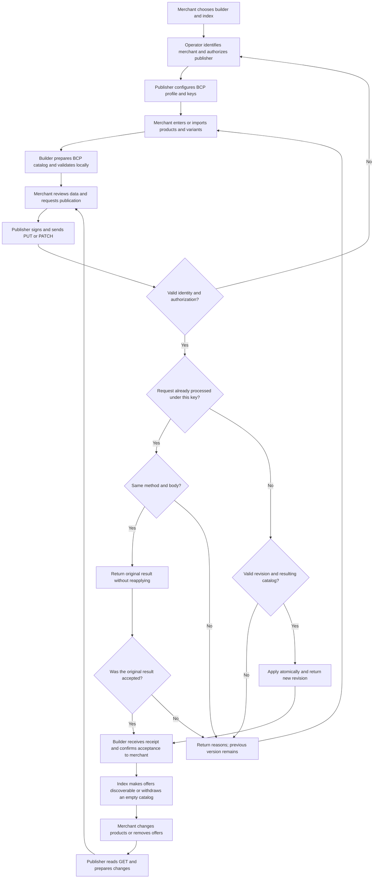

<!-- Copyright 2026 BCP Authors. Licensed under the Apache License, Version 2.0. -->

# Catalog creation and publication

This specification defines `br.dev.bcp.shopping.catalog.publish`: how any
catalog builder submits a merchandise catalog to a BCP index and maintains
its products.

The index receives and stores a copy of the catalog. Admission is automatic
after authentication, authorization and technical conformance; neither human
approval nor an operational sales agent is required. Negotiation, checkout
and payment are separate stages. Published prices are declared offers;
checkout confirms the purchase terms, as described by the
[catalog capability](index.md).

**MUST**, **MUST NOT** and **MAY** indicate normative requirements.

## Merchant journey

The merchant chooses a **catalog builder**: an ERP, an e-commerce platform, a
registration assistant or its own application. The builder prepares the data;
the **publisher** signs and sends requests and may be operated by the merchant
or a third party. The **index** validates, stores and makes offers
discoverable, under the responsibility of the **index operator**. These roles
are defined in the [glossary](../glossary.md#commerce).

Before initial publication, the operator MUST establish merchant identity and
authorize the publisher to act for `merchant_id`. The publisher makes its BCP
profile and keys available. A signature proves the signer's identity; it does
not by itself prove that the signer represents the merchant. Proof and delegation
belong to the operator's onboarding process, a prerequisite of this contract;
this specification does not create an onboarding API.

`merchant_id` is the merchant's identifier at the index, assigned by the
operator during onboarding. The operator MUST bind it to the merchant's CNPJ,
the same one the merchant declares in `seller_identity` (see
[Fiscal identity](../fiscal-identity.md)), and, when the merchant has a BCP
profile, to that profile's URL. `merchant_id` does not replace the CNPJ:
checkouts and orders still declare `seller_identity`.



## Discovery

The index MUST publish its profile at `/.well-known/bcp`, declaring the
`br.dev.bcp.shopping.catalog.publish` capability and a `br.dev.bcp.shopping`
service with `transport: rest`. That service's `endpoint` is the base of the
[REST binding](#publication-rest-binding) URLs. The publisher MUST declare the
same capability in the profile it advertises in `BCP-Agent`. Protocol and
capability versions are negotiated through these profiles, following the
[negotiation protocol](../overview.md#negotiation-protocol).

## Schema coverage

| Concept | Existing coverage | Publication composition |
| :-- | :-- | :-- |
| Product | `product.json`: description, options, variants and price ranges | `publish_product` references the product and its publication variants |
| Variant | `variant.json`: price, generic options, SKU and availability | `publish_variant` adds mandatory NCM |
| Price | `price.json` and `amount.json`: explicit currency and nonnegative integer | Reused unchanged; zero is allowed |
| Fiscal classification | `ncm.json`: eight-digit string; `tax.json` associates NCM with checkout/order | Publication associates NCM with every purchasable variant |
| Search and lookup | `catalog_search.json` and `catalog_lookup.json` | Existing read contracts preserved |

The [publication schema](https://bcp.dev.br/{{ bcp_version }}/schemas/shopping/catalog_publish.json)
defines complete documents and operation bodies. Vendored types remain
unchanged; additions use `$ref`/`allOf`.
Every body MUST be validated against its operation's `$defs` from the operation
table; the file root is a contract container, as in the read capabilities.

| Entity | Required | Optional |
| :-- | :-- | :-- |
| Product | `id`, `title`, `description`, `price_range`, `variants` with at least one entry | All other [Product](index.md#product) fields, including categories, media, options, tags and metadata |
| Variant | `id`, `title`, `description`, `price`, `ncm` | Other [Variant](index.md#variant) fields, including SKU, barcodes, options, media and availability |
| Price | `amount`, `currency` | As defined by existing types |
| NCM | String of exactly eight digits | — |

IDs MUST NOT contain whitespace; titles MUST contain non-whitespace characters.
Product and variant IDs MUST remain stable, identify their origin globally and
be unique across all products and variants in a catalog. A publisher/merchant
namespace such as `gid://loja.example/Variant/caneca-250` is recommended. Names
and SKUs do not replace IDs. The variant ID remains the checkout item ID.

A description MUST contain nonblank text in at least one recognized format:
`plain`, `html` or `markdown`. Clients MUST sanitize rich content before rendering.
Commercial categories and NCM serve different purposes: discovery and declared
fiscal classification, respectively.

`price.amount` MUST be a nonnegative integer in the currency's minor units:
BRL 25.00 is represented as `2500`/`BRL`. Zero is a valid price.

## Publication REST binding

This binding is specific to index publication and does not change search/lookup
bindings. URLs are relative to the `endpoint` advertised in the index profile.
A catalog is identified by the `(merchant_id, catalog_id)` pair: the publisher
chooses a `catalog_id`, unique within the merchant and stable. Both are encoded
as URL path segments. The number of catalogs per merchant is not fixed.

| Operation | Body/schema | Result |
| :-- | :-- | :-- |
| `PUT /merchants/{merchant_id}/catalogs/{catalog_id}` | `replace_request`: `base_revision`, `products` | `201` on creation; `200` on replacement |
| `PATCH /merchants/{merchant_id}/catalogs/{catalog_id}` | `update_request`: `base_revision`, `upsert_products`, `remove_product_ids` | `200`; an existing catalog is required |
| `GET /merchants/{merchant_id}/catalogs/{catalog_id}` | No body; authenticated, authorized publisher | `200` with `catalog`, or `404` if absent |

Requests do not carry the `ucp` envelope: protocol and capability versions come
from negotiation through the publisher's profile. Negotiation failures follow
the overview's [error handling](../overview.md#error-handling), including
`422`/`version_unsupported`. Responses and the GET snapshot carry `ucp` with the
version used and exactly one publication capability version. Examples use
protocol base `2026-04-08` and capability `2026-10-04`.

Complete publication:

```json
--8<-- "fixtures/valid/catalog-publish-replace.json"
```

Price update using a complete product:

```json
--8<-- "fixtures/valid/catalog-publish-update.json"
```

### PUT body

{{ extension_schema_fields('catalog_publish.json#/$defs/replace_request', 'catalog') }}

### PATCH body

{{ extension_schema_fields('catalog_publish.json#/$defs/update_request', 'catalog') }}

### GET snapshot

{{ extension_schema_fields('catalog_publish.json#/$defs/catalog', 'catalog') }}

### Revisions, updates and atomicity

- On creation by PUT, `base_revision` MUST be `null`; the assigned revision is `1`.
- After creation, PUT/PATCH MUST supply the current revision. Each newly accepted
  write increments it by one, including a removal with no effect. Integer catalog
  revisions are independent of protocol versions.
- PUT replaces the whole catalog; absent products leave the active version.
  PATCH upserts by `product.id`, replacing each complete product, including its
  variants. Changing a variant requires its complete product; fields are not merged.
- PATCH MUST contain at least one upsert or removal. Removing an absent product
  has no effect. Repeating an ID in `remove_product_ids`, or both upserting and
  removing the same product in a batch, is invalid.
- The index MUST validate the resulting catalog and commit the revision, changes
  and idempotency receipt atomically. Failure changes no product and does not
  advance the revision. Concurrent writes against the same revision cannot both
  be accepted.
- An empty catalog is valid and removes all its offers from discovery. Merchant
  association and revision remain.
- A stale revision returns `409`/`revision_conflict`. The client MUST read the
  current version and reapply its intent, without silently overwriting another
  publisher's changes.

### Idempotency and responses

Every write MUST include `Idempotency-Key`. Its scope is
`(authenticated publisher identity, merchant_id, catalog_id, key)`. The index
MUST authenticate and authorize every attempt, including retries.

Repeating the same method, catalog and JSON body under a processed key MUST
return the original HTTP status and receipt before checking the current revision,
without reapplying the write. Matching uses SHA-256 of received body bytes,
following the BCP signature and idempotency contract: reordering properties or
changing whitespace also changes this digest. Another operation or body under
that key returns `409`/`idempotency_conflict`. Duplicate JSON members and
nonfinite numbers are invalid.

The index MUST atomically record each processed attempt's result, including
`404`, revision `409` and `422` rejections. A rejection preserves the catalog
but reserves its key; corrected data or revisions require a new key.
An idempotency conflict MUST NOT replace the original record. Authentication,
authorization, parsing and storage failures are not processed attempts in this
record; authorization is always rechecked.

Keys MUST follow BCP requirements, including at least 128 bits of entropy.
The operator MUST document receipt retention of at least 24 hours; 48 hours
is recommended. Failure to persist idempotency state MUST reject the write
with `503`, preserving the previous catalog. The client MUST retry an ambiguous
attempt with the same key within that period, and must not assume a new revision
merely because it lost the response. The receipt confirms catalog persistence
and activation in this index; it does not promise display by other operators.

```json
--8<-- "fixtures/valid/catalog-publish-response.json"
```

{{ extension_schema_fields('catalog_publish.json#/$defs/publish_response', 'catalog') }}

GET returns the accepted snapshot, including all products, `catalog_id`,
`merchant_id`, `revision` and `ucp`. A write retry returns its original receipt
even if GET already returns a later revision.

### Authentication and authorization

Requests MUST follow [Message signatures](../signatures.md): `BCP-Agent`,
`Signature-Input`, `Signature` and, when there is a body, SHA-256
`Content-Digest` and `Content-Type: application/json`. Every write includes
and signs `Idempotency-Key`. Method, authority, path and query components when
present follow that specification. Responses follow its signing rules.
ES256 verification is mandatory; other algorithms follow existing BCP support.

The index MUST verify the publisher's authorization for the path's
`merchant_id` before looking up the catalog. GET requires read authorization;
PUT/PATCH require write authorization. Without authorization the response is
`403`/`publisher_not_authorized`, whether or not the catalog exists, so other
merchants' catalogs are not disclosed. Because `catalog_id` is scoped by
merchant, a publisher cannot claim another merchant's catalog identifier.
Authorization is rechecked on retries and MUST respect revocation.

`publisher_not_authorized` signals a missing delegation for a publisher
authenticated by signature. It is distinct from `insufficient_scope`, which
refers to user token scopes in [Identity linking](../identity-linking.md).

| Failure | HTTP/code |
| :-- | :-- |
| Invalid JSON or missing request identifiers | `400` |
| Missing/invalid signature or key not found | `401`, signature-spec codes |
| Digest mismatch, unsupported algorithm or profile discovery failure | Existing protocol statuses and codes |
| Publisher not authorized for the merchant | `403`/`publisher_not_authorized` |
| Catalog absent in GET/PATCH | `404`/`catalog_not_found` |
| Revision or idempotency conflict | `409`/`revision_conflict` or `idempotency_conflict` |
| Nonconforming payload or resulting catalog | `422`, codes below |

Errors use the existing `error_response`: `ucp.status: error` and `messages`
with `type`, `code`, `path`, `content` and `severity`. `path` is JSONPath;
structural validation points to the request, while resulting-catalog checks
may point to `$.products[...]` in the candidate snapshot.

## Automatic conformance

After schema validation, the index MUST apply these rules:

| Rule | Rejection code (`422`) |
| :-- | :-- |
| Invalid type, format, required field or cardinality | `catalog_schema_invalid` |
| Repeated IDs across products and variants | `catalog_id_duplicate` |
| No recognized description format containing nonblank text | `catalog_description_empty` |
| Different currencies within a product, including optional prices | `catalog_currency_mismatch` |
| `price_range` differs from minimum/maximum variant prices | `catalog_price_range_mismatch` |
| Blank/ambiguous option names or values | `catalog_options_invalid` |
| Undefined, incomplete, repeated or incompatible selections, or the same selections as another variant | `catalog_option_selection_invalid` |
| PATCH with neither upserts nor removals | `catalog_update_empty` |
| Same product upserted and removed in a batch | `catalog_update_overlap` |

Options are generic. Each variant MUST select every declared product option
exactly once, and two variants of the same product MUST NOT have the same
combination of values. Values are identified by `id` when supplied; their
`label` MUST also match the definition. Without an ID, the label identifies the
value. Option names and labels are compared exactly; all Cartesian combinations
need not be available. Different products may use different currencies.

NCM validation requires only presence and eight digits. It does not query a
remote table or certify validity dates or suitability for a product. Media and
descriptions are declared by the publisher; conformance does not establish stock,
commercial availability or eligibility to negotiate.

### Reference validator

The CLI runs offline and statelessly: it does not authenticate, persist or
communicate with the index. It checks a document against the schema and the
conformance rules above. Revisions, idempotency and authorization depend on
index state and are out of its scope. It uses local schemas and does not
retrieve `$ref` over the network.

```bash
uv run --group playground python scripts/validate_catalog.py \
  fixtures/valid/catalog-publish-replace.json

uv run --group playground python scripts/validate_catalog.py \
  fixtures/valid/catalog-publish-update.json --operation update

uv run --group playground python scripts/validate_catalog.py \
  fixtures/valid/catalog-publish-snapshot.json --operation catalog
```

JSON output contains `conformant` and `messages`, the latter in the
`message_error` format. For a PATCH, the CLI checks only the submitted products;
ID uniqueness against the current catalog is checked by the index on the
resulting catalog.

Exit codes: `0` for a conforming document; `1` for nonconformance with
structured errors; `2` for usage, reading or invalid-JSON errors. `make check`
runs the CLI over the fixtures (`--fixtures`): valid publication fixtures must
conform, and every fixture in `fixtures/conformance/` must fail with the code
and `path` declared in `fixtures/expectations.json`.

## Index conformance scenarios

Index implementations MUST cover these scenarios in their acceptance tests.
Every rejection preserves the previous catalog, revision and successful receipts.

| HTTP scenario | Expected result |
| :-- | :-- |
| Conforming PUT, valid ES256 signature and merchant delegation | `201`, revision `1`, receipt and activated offers |
| Authorized GET, signed under the bodyless request profile | `200`, current snapshot and revision |
| Missing/tampered signature, including changed `Idempotency-Key` | `401`/`signature_missing` or `signature_invalid` |
| `keyid` absent from the profile after revocation | `401`/`key_not_found` |
| Body changed without recalculating `Content-Digest` | `400`/`digest_mismatch` |
| Valid signature without write delegation for the path's `merchant_id` | `403`/`publisher_not_authorized` |
| GET for a merchant without read delegation, whether or not the catalog exists | `403`/`publisher_not_authorized`, without disclosing whether the catalog exists |
| Identical authorized retry after a later revision was accepted, including a previously rejected attempt | Original result and status; no revision increment |
| Retry after delegation revocation, even with an existing receipt | `403`; the receipt is not disclosed |
| Same scope and key with a different method or body bytes | `409`/`idempotency_conflict` |
| Two concurrent new writes against the same base revision | One succeeds; the other receives `409`/`revision_conflict` |
| Batch containing valid upserts and a nonconforming product | `422` with code and `path`; no part is applied |
| Failure to persist catalog/revision/receipt in one transaction | Fail closed; `503` for unavailability, no partial acceptance |

Any catalog builder follows the same contracts, examples and fixtures. The BCP
specification is normative; builder or index implementations do not define the
standard.
