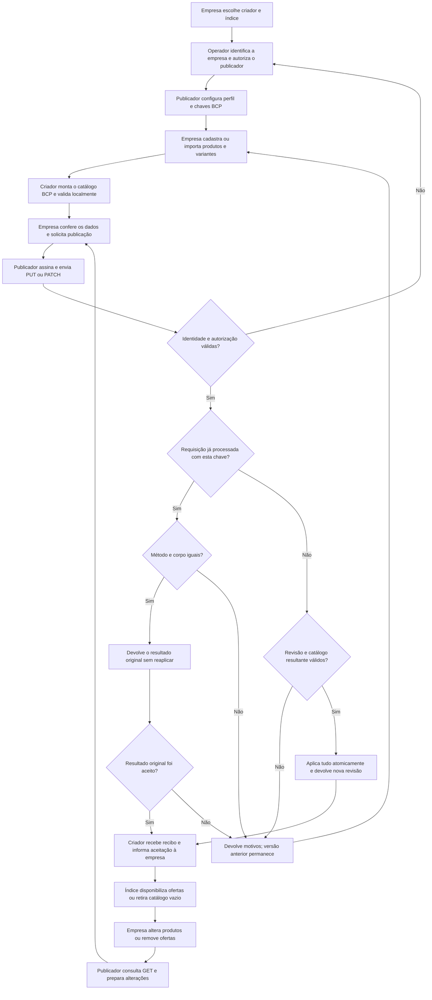

<!-- Copyright 2026 BCP Authors. Licensed under the Apache License, Version 2.0. -->

# Criação e publicação de catálogos

Esta especificação define a capability `br.dev.bcp.shopping.catalog.publish`:
como qualquer criador envia um catálogo de mercadorias a um índice BCP e mantém
seus produtos atualizados.

O índice recebe e mantém uma cópia do catálogo. A admissão é automática após
autenticação, autorização e conformidade técnica; não exige aprovação humana
nem agente de vendas operacional. Negociação, checkout e pagamento são etapas
separadas. Os preços publicados são ofertas declaradas; o checkout confirma os
termos da compra, conforme a [capacidade de catálogo](index.md).

Os termos **DEVE**, **NÃO DEVE** e **PODE** indicam requisitos normativos.

## Jornada da empresa

A empresa escolhe um criador de catálogo: BIA, ERP, plataforma ou aplicação
própria. O criador prepara os dados; o **publicador** é o serviço que assina e
envia as requisições, podendo ser operado pela própria empresa ou por um terceiro.
O **índice** valida, armazena e disponibiliza as ofertas para descoberta.

Antes da primeira publicação, o operador DEVE estabelecer a identidade do
lojista e autorizar o publicador a agir pelo `merchant_id`. O publicador
disponibiliza seu perfil BCP e suas chaves. Assinar uma mensagem prova a
identidade do signatário; não prova, por si só, sua representação da empresa.
O mecanismo de comprovação e delegação pertence ao cadastro do operador, como
pré-requisito deste contrato; esta especificação não cria uma API de onboarding.



## Cobertura dos schemas

| Conceito | Cobertura existente | Composição para publicação |
| :-- | :-- | :-- |
| Produto | `product.json`: descrição, opções, variantes e faixas de preço | `publication_product.json` referencia o produto e suas variantes fiscais |
| Variante | `variant.json`: preço, opções genéricas, SKU e disponibilidade | `publication_variant.json` acrescenta NCM obrigatório |
| Preço | `price.json` e `amount.json`: moeda explícita e inteiro não negativo | Reutilizados sem alteração; zero é permitido |
| Classificação fiscal | `ncm.json`: string com oito dígitos; `tax.json` associa NCM a checkout/pedido | O perfil de publicação associa NCM a cada variante vendável |
| Busca e consulta | `catalog_search.json` e `catalog_lookup.json` | Contratos de leitura existentes preservados |

O [schema de publicação](https://bcp.dev.br/{{ bcp_version }}/schemas/shopping/catalog_publication.json)
define os documentos completos e os corpos de cada operação. Os tipos
vendorados não são modificados; as adições usam `$ref`/`allOf`.
Cada corpo DEVE ser validado pela `$defs` correspondente da tabela de operações;
a raiz do arquivo é um container de contratos, como nas capabilities de leitura.

| Entidade | Obrigatórios | Opcionais |
| :-- | :-- | :-- |
| Produto | `id`, `title`, `description`, `price_range`, `variants` com ao menos um item | Todos os demais campos do produto BCP, incluindo categorias, mídia, opções, tags e metadata |
| Variante | `id`, `title`, `description`, `price`, `ncm` | Demais campos de variante, incluindo SKU, códigos de barras, opções, mídia e disponibilidade |
| Preço | `amount`, `currency` | Conforme os tipos existentes |
| NCM | String com exatamente oito dígitos | — |

IDs e títulos DEVEM conter caracteres além de espaços. IDs de produto e
variante DEVEM ser estáveis, identificar globalmente a origem e ser únicos
entre todos os produtos e variantes do catálogo. Recomenda-se um namespace
do publicador/lojista, como `gid://loja.example/Variant/caneca-250`. Nome e SKU
não substituem IDs. O ID da variante continua sendo o ID do item no checkout.

Descrição DEVE conter texto não vazio em ao menos um formato reconhecido:
`plain`, `html` ou `markdown`. Clientes DEVEM sanitizar conteúdo rico antes
de renderizá-lo. Categoria comercial é distinta do NCM: a primeira serve à
descoberta; o segundo identifica a classificação fiscal declarada.

`price.amount` DEVE ser inteiro não negativo em unidades menores da moeda:
R$ 25,00 corresponde a `2500`/`BRL`. Preço zero é válido.

## Binding REST de publicação

O binding a seguir é próprio da publicação no índice. Não altera os bindings
de busca/consulta. URLs são relativas à base HTTPS anunciada pelo operador.
O `catalog_id` é escolhido pelo publicador, permanece estável dentro do índice
e é codificado como segmento da URL. A criação o vincula imutavelmente ao
`merchant_id` autorizado. A quantidade de catálogos por lojista não é fixada.

| Operação | Corpo/schema | Resultado |
| :-- | :-- | :-- |
| `PUT /catalogs/{catalog_id}` | `replace_request`: `ucp`, `merchant_id`, `base_revision`, `products` | `201` na criação; `200` na substituição |
| `PATCH /catalogs/{catalog_id}` | `update_request`: `ucp`, `merchant_id`, `base_revision`, `upsert_products`, `remove_product_ids` | `200`; exige catálogo existente |
| `GET /catalogs/{catalog_id}` | Sem corpo; publicador autenticado e autorizado | `200` com `catalog`, ou `404` se inexistente |

O envelope `ucp` DEVE declarar a versão do protocolo por data e exatamente
uma versão da capability de publicação em `ucp.capabilities`. Versões sem
suporte são rejeitadas com `422`/`version_unsupported`. Os exemplos usam a
base `2026-04-08` e a capability `2026-10-04`; esses são também os valores
suportados pelo validador de referência deste rascunho.

Publicação completa:

```json
--8<-- "fixtures/valid/catalog-publication-replace.json"
```

Atualização de preço com produto completo:

```json
--8<-- "fixtures/valid/catalog-publication-update.json"
```

### Revisões, atualização e atomicidade

- Na criação por PUT, `base_revision` DEVE ser `null`; a revisão atribuída é `1`.
- Depois da criação, PUT/PATCH DEVEM informar a revisão atual. Cada escrita
  inédita aceita incrementa a revisão em um, inclusive remoção sem efeito.
  A revisão inteira do catálogo é independente das versões do protocolo.
- PUT substitui o catálogo completo; produtos ausentes deixam de integrar a
  versão ativa. PATCH faz upsert por `product.id`, substituindo cada produto
  inteiro, incluindo suas variantes. Alterar uma variante exige enviar seu
  produto completo; os campos não são mesclados.
- PATCH DEVE conter ao menos uma inclusão/alteração ou remoção. Remover produto
  inexistente não tem efeito. Repetir ID em `remove_product_ids`, ou incluir e
  remover o mesmo produto no lote, é inválido.
- O índice DEVE validar o catálogo resultante e efetivar a revisão, as alterações
  e o recibo de idempotência atomicamente. Uma falha não altera nenhum produto
  nem avança a revisão. Escritas concorrentes contra a mesma revisão não podem
  ambas ser aceitas.
- Catálogo vazio é válido e retira todas as suas ofertas da descoberta.
  A associação ao lojista e a revisão permanecem.
- Revisão desatualizada retorna `409`/`revision_conflict`. O cliente DEVE ler
  a versão atual e reaplicar sua intenção; não deve substituir silenciosamente
  mudanças de outro publicador.

### Idempotência e respostas

Toda escrita DEVE incluir `Idempotency-Key`. O escopo da chave é
`(identidade autenticada do publicador, catalog_id, chave)`. O índice DEVE
autenticar e autorizar cada tentativa, inclusive repetições.

Repetir o mesmo método, catálogo e corpo JSON com uma chave já processada DEVE
devolver o status HTTP e o recibo originais, antes de conferir a revisão
atual, sem reaplicar a escrita. A comparação usa SHA-256 dos bytes do corpo
recebido, conforme o contrato BCP de assinaturas e idempotência: reordenar
propriedades ou mudar espaços também muda esse digest. Outra operação ou corpo
sob a mesma chave retorna `409`/`idempotency_conflict`. JSON com membros
duplicados ou números não finitos é inválido.

O índice DEVE registrar atomicamente o resultado de cada tentativa processada,
incluindo rejeições `404`, `409` de revisão/identidade e `422`. Uma rejeição não
altera o catálogo, mas reserva sua chave; corrigir os dados ou a revisão exige
uma chave nova. Conflito de idempotência NÃO DEVE substituir o registro original.
Falhas de autenticação, autorização, parsing ou armazenamento não constituem
tentativas processadas neste registro; a autorização sempre é reavaliada.

As chaves DEVEM seguir os requisitos BCP, incluindo pelo menos 128 bits de
entropia. O operador DEVE documentar a retenção de recibos, de no mínimo 24 horas,
com 48 horas recomendadas. Falha de persistência da idempotência DEVE rejeitar
a escrita com `503`, preservando o catálogo anterior. O cliente DEVE repetir uma
tentativa ambígua com a mesma chave dentro desse período; nunca assumir uma
revisão nova apenas porque perdeu a resposta. O recibo confirma persistência
e ativação do catálogo no índice, sem prometer exibição por outros operadores.

```json
--8<-- "fixtures/valid/catalog-publication-response.json"
```

GET retorna o snapshot aceito, incluindo todos os produtos, `catalog_id`,
`merchant_id`, `revision` e `ucp`. Uma repetição de escrita devolve o recibo
original, mesmo que GET já retorne uma revisão posterior.

### Autenticação e autorização

As requisições DEVEM seguir [Assinaturas de mensagens](../signatures.md):
`BCP-Agent`, `Signature-Input`, `Signature` e, quando houver corpo,
`Content-Digest` SHA-256 e `Content-Type: application/json`. Toda escrita inclui
e assina `Idempotency-Key`. Os componentes de método, autoridade, caminho e
query quando presente seguem a mesma spec. Respostas seguem suas regras de
assinatura. A verificação de ES256 é obrigatória; outros algoritmos seguem o
suporte já definido pelo BCP.

O índice DEVE verificar autorização para o `merchant_id` antes de revelar ou
alterar seu catálogo. GET exige autorização de leitura; PUT/PATCH exigem
autorização de escrita. Uma assinatura válida sem autorização retorna `403`.
A autorização é reavaliada em repetições e deve respeitar revogação.

| Falha | HTTP/código |
| :-- | :-- |
| JSON inválido ou identificadores de requisição ausentes | `400` |
| Assinatura ausente/inválida ou chave não encontrada | `401`, códigos da spec de assinaturas |
| Digest divergente, algoritmo sem suporte ou falha de descoberta de perfil | Status e códigos já definidos pelo protocolo |
| Publicador sem autorização | `403`/`insufficient_scope` |
| Catálogo inexistente em GET/PATCH | `404`/`catalog_not_found` |
| Mudança da identidade de catálogo/lojista | `409`/`catalog_identity_conflict` |
| Revisão ou idempotência em conflito | `409`/`revision_conflict` ou `idempotency_conflict` |
| Payload ou catálogo resultante inconforme | `422`, códigos abaixo |

Erros usam o `error_response` existente: `ucp.status: error` e `messages`
com `type`, `code`, `path`, `content` e `severity`. `path` é JSONPath;
validações estruturais apontam para a requisição e verificações do catálogo
resultante podem apontar para `$.products[...]` no snapshot candidato.

## Conformidade automática

Depois de validar o schema, o índice DEVE aplicar estas regras:

| Regra | Código de rejeição (`422`) |
| :-- | :-- |
| Tipo, formato, campo obrigatório ou cardinalidade inválidos | `catalog_schema_invalid` |
| IDs repetidos entre produtos e variantes | `catalog_id_duplicate` |
| Nenhum formato de descrição reconhecido com texto preenchido | `catalog_description_empty` |
| Moedas diferentes dentro do mesmo produto, incluindo preços opcionais | `catalog_currency_mismatch` |
| `price_range` diferente do mínimo/máximo dos preços das variantes | `catalog_price_range_mismatch` |
| Nomes de opções ou valores vazios/ambíguos | `catalog_options_invalid` |
| Seleções sem definição, incompletas, repetidas ou incompatíveis | `catalog_option_selection_invalid` |
| PATCH sem alteração nem remoção | `catalog_update_empty` |
| Produto incluído e removido no mesmo lote | `catalog_update_overlap` |

Opções são genéricas. Cada variante DEVE selecionar exatamente uma vez cada
opção declarada pelo produto. Valores são identificados por `id` quando informado;
seu `label` também DEVE corresponder à definição. Sem ID, o label identifica o
valor. Nomes de opções e labels são comparados exatamente; não se exige que
todas as combinações cartesianas estejam disponíveis. Produtos diferentes
podem usar moedas diferentes.

A validação de NCM exige somente presença e oito dígitos. Não consulta tabela
remota, não certifica vigência nem adequação ao produto. Mídia e descrições
são declaradas pelo publicador; conformidade não comprova existência de estoque
nem disponibilidade comercial ou habilitação para negociar.

### Validador de referência

O CLI roda offline, sem persistência, autenticação, autorização ou comunicação
com o índice. É uma referência executável de conformidade e transições; não
é a API de produção. Usa os schemas locais e não busca `$ref` na rede.

```bash
uv run --group playground python scripts/validate_catalog.py \
  fixtures/valid/catalog-publication-replace.json \
  --catalog-id catalogo-loja-exemplo --idempotency-key criacao-1

uv run --group playground python scripts/validate_catalog.py \
  fixtures/valid/catalog-publication-update.json --operation update \
  --catalog-id catalogo-loja-exemplo --idempotency-key atualizacao-1 \
  --current fixtures/valid/catalog-publication-snapshot.json

uv run --group playground python scripts/validate_catalog.py \
  fixtures/valid/catalog-publication-snapshot.json --operation catalog
```

A saída JSON tem `http_status`, `response`, `catalog` e `receipt`. `catalog`
é o novo snapshot candidato quando há escrita aceita; numa repetição, é `null`
para indicar que nada deve ser reaplicado. `receipt` registra a requisição
processada e seu resultado, inclusive rejeições; o CLI calcula o digest dos
bytes do arquivo original.
Para simular uma repetição, mantenha esses bytes e extraia o objeto de recibo para
um arquivo e informe `--receipt`; use `--publisher-id` para distinguir publicadores.
Snapshot e recibo são **estado confiável do índice**, nunca campos enviados
pelo cliente HTTP. O CLI não mantém histórico por conta própria.

Códigos de saída: `0` para conformidade/aceitação; `1` para rejeição com erros
estruturados; `2` para erro de uso, leitura ou JSON inválido.
`make check` valida os schemas e as fixtures estruturais, além de verificar
os snapshots do playground.

## Integração futura do índice e da BIA

Esta entrega especifica o contrato; não implementa os serviços do índice nem
muda o cadastro local da BIA. O índice futuro deve colocar os schemas/SDK na
fronteira de transport e manter seus modelos internos independentes do protocolo.
Os testes de aceitação da API futura DEVEM comprovar estes cenários. Em toda
rejeição, catálogo, revisão e recibos de sucesso anteriores permanecem intactos.

| Cenário HTTP | Resultado esperado |
| :-- | :-- |
| PUT conforme, assinatura ES256 válida e delegação para o lojista | `201`, revisão `1`, recibo e ofertas ativadas |
| GET autorizado, assinado conforme o perfil de requisição sem corpo | `200`, snapshot e revisão atuais |
| Assinatura ausente ou adulterada, incluindo alteração de `Idempotency-Key` | `401`/`signature_missing` ou `signature_invalid` |
| `keyid` ausente do perfil após revogação | `401`/`key_not_found` |
| Corpo alterado sem recalcular `Content-Digest` | `400`/`digest_mismatch` |
| Assinatura válida sem delegação de escrita para `merchant_id` | `403`/`insufficient_scope` |
| GET de catálogo de outro lojista sem delegação de leitura | `403`, sem expor o catálogo |
| Repetição idêntica autorizada após outra revisão aceita, inclusive de uma rejeição anterior | Resultado e status originais; revisão não avança |
| Repetição após revogação da delegação, mesmo com recibo existente | `403`; recibo não é revelado |
| Mesmo escopo e chave com outro método ou bytes do corpo | `409`/`idempotency_conflict` |
| Duas escritas inéditas concorrentes com a mesma revisão base | Uma aceita; a outra recebe `409`/`revision_conflict` |
| Lote com inclusões válidas e produto inconforme | `422` com código e `path`; nenhuma parte é aplicada |
| Falha ao persistir catálogo/revisão/recibo na mesma transação | Falha fechada; `503` para indisponibilidade, sem aceite parcial |

O adapter da BIA DEVE:

- Preservar os IDs de produto/variante persistidos, com namespace estável. Os
  modelos públicos atuais não carregam esses IDs; o adapter deve recuperá-los
  da persistência em vez de derivá-los do nome ou da ordem da conversa.
- Converter `name` em `title`, `description` em conteúdo BCP e `price_cents`
  em `price.amount`/`currency: BRL`. O preço atual do produto é copiado às
  variantes; `price_range` é calculado a partir dos preços enviados.
- Criar a variante vendável persistida para produtos sem opções; mapear cor,
  tamanho ou outras dimensões para opções genéricas, sem torná-las obrigatórias
  no protocolo. Copiar o NCM do produto a cada variante; variantes poderão
  posteriormente ter classificação própria.
- Expor imagens por URLs adequadas à descoberta, em vez de enviar `image_ref`
  interno. Campos específicos do cliente podem usar `metadata`; não viram
  requisitos universais de admissão.
- Coletar campos obrigatórios ausentes e informar pendências, sem inventar
  descrição ou NCM. A confirmação local e a aceitação no índice DEVEM ter
  estados distintos. Somente o recibo de sucesso registra a aceitação na rede.
- Guardar catálogo, revisão e chave de tentativa, permitindo correção, retry
  idempotente e atualização sem depender do prompt da BIA.

Qualquer outro criador segue os mesmos contratos, exemplos e testes. A
especificação do BCP é a fonte normativa; regras locais de conversa e a
implementação da BIA não definem o padrão.
